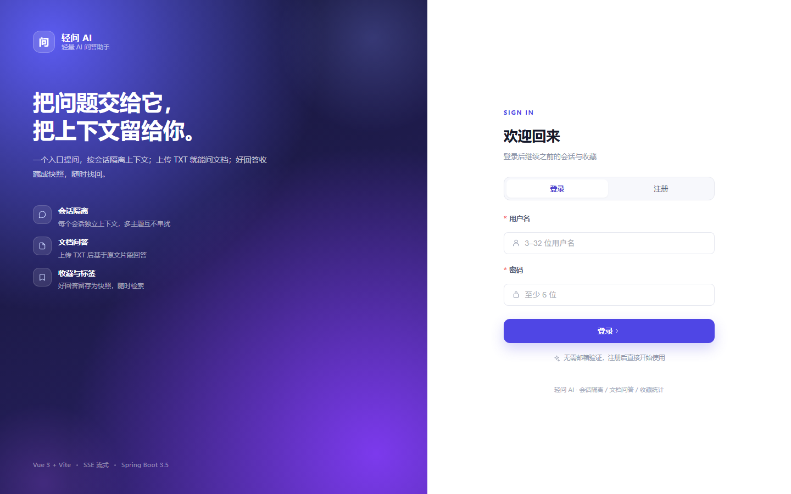
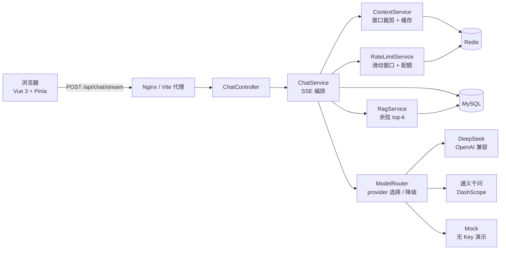

# ai-chat-assistant · 轻问 AI

一个可独立部署的**多会话 AI 问答助手**：会话之间上下文隔离，支持 SSE 流式回答、停止生成、历史落库、TXT 文档问答（轻量 RAG）、回答收藏与标签，以及限流、配额、重试、降级、调用日志等模型网关能力。

前端在界面里叫「轻问 AI」，技术栈刻意收敛在单体应用内：**不引入 Spring Cloud、消息队列、向量数据库或 K8s**。



---

## 目录

- [1. 项目解决什么问题](#1-项目解决什么问题)
- [2. 主要功能](#2-主要功能)
- [3. 安装方法](#3-安装方法)
- [4. 使用方法](#4-使用方法)
- [5. 输入输出示例](#5-输入输出示例)
- [6. 接口一览](#6-接口一览)
- [7. 架构与请求链路](#7-架构与请求链路)
- [8. 数据模型](#8-数据模型)
- [9. 关键设计](#9-关键设计)
- [10. 测试与验证](#10-测试与验证)
- [11. 已知限制与刻意不做](#11-已知限制与刻意不做)
- [12. 相关文档](#12-相关文档)
- [License](#license)

---

## 1. 项目解决什么问题

很多 AI 对话产品看起来只是“输入框 + 模型接口”，真正难的是把下面几件事同时做对：

- **不同话题不要互相污染**：每个会话有自己的上下文窗口，切换会话后不会把上一个话题带进来。
- **流式回答要可中断、可回看**：逐字输出，点“停止生成”后保留已经生成的部分；刷新页面仍能在历史里看到。
- **文档问答不想背一套向量数据库**：上传 TXT 后切分、向量化、按余弦相似度召回，全部复用 MySQL + Java。
- **好回答需要留得住**：收藏保存的是问答快照，原会话删掉也不影响收藏。
- **模型调用要有边界**：首字节前失败可重试、可跨提供方降级；开始输出后不重试；限流、每日 token 配额、并发闸门和调用日志都要有。

这个项目就是把这些能力做进一个可运行的单体里：适合作为学习/演示项目，也可以作为中小规模内部问答工具的基础骨架。

> 它**不是**通用知识库平台、团队协作工具或多租户 SaaS。权限模型只有“登录用户”，没有组织、角色和用户管理后台。

---

## 2. 主要功能

### 2.1 账号与会话

- 注册、登录、登出。
- 密码使用 **BCrypt** 存储；登录签发 **HS256 JWT**，默认有效期 7 天。
- 登出时把 JWT 的 `jti` 写入 Redis 黑名单，TTL 等于 token 剩余有效期，实现无状态 token 的主动失效。
- 新建会话时可选择模型提供方和模型，也可填写标题；不填标题时默认为「新会话」。
- 会话支持重命名、物理删除、切换；会话列表带最近一条消息摘要（40 字）。
- 首条提问后，如果标题仍是默认值，会自动截取提问前 20 字作为标题；手动改过标题则不再覆盖。

### 2.2 流式问答与历史

- `POST /api/chat/stream` 返回 **SSE**，事件包括 `meta`、`delta`、`usage`、`done`、`error`。
- 前端使用 `fetch + ReadableStream` 消费，而不是 `EventSource`：流式接口需要 POST，且 token 放在 `Authorization` 头里，不进入 URL。
- 支持**停止生成**：前端 `AbortController` 中断请求，后端把已生成内容以 `ABORTED` 状态落库。
- 每条消息落库，记录角色、内容、实际生效的 `provider/model`、token 用量、耗时和状态。
- 历史消息按 id 倒序分页返回，前端再反转成“旧 → 新”展示。
- 消息状态：
  - `STREAMING`：生成中的临时占位；
  - `COMPLETED`：正常完成；
  - `ABORTED`：客户端中断或断开，保留半截回答；
  - `FAILED`：上游失败且重试/降级耗尽。

### 2.3 TXT 文档问答（轻量 RAG）

- 只接受 `.txt`，单文件不超过 **1MB**，每个用户最多 **10 份**。
- 上传后同步解析：优先严格按 UTF-8 解码，失败再按 GBK，尽量兼容中文 TXT。
- 切分规则：段落优先；长段落按句号/问号/分号/换行切分，目标 **400 字**、重叠 **80 字**。
- 向量化：配置 `DASHSCOPE_API_KEY` 时使用通义 `text-embedding-v3`（1024 维）；没有 Key 时使用确定性的 512 维 mock 向量。
- 向量以 `float32` 小端 BLOB 存入 MySQL；召回时一次取出该文档全部分片，在 Java 里做余弦相似度，取 **top-5**，相似度低于 **0.3** 的片段被过滤。
- 一个会话最多绑定一份文档；文档删除后，引用它的会话会自动解绑。
- 文档状态：`PARSING` / `READY` / `EMBED_FAILED`。

> 注意：mock 向量只保证链路可跑，**没有语义检索能力**；并且 mock 对话模型只返回固定模板，不会引用文档片段。没有真实 embedding Key 时，不要用文档问答效果做判断。

### 2.4 收藏与标签

- 把一轮问答保存为**快照**（问题 + 回答 + 来源 provider/model），不依赖原会话是否还存在。
- 支持在收藏时选择已有标签，或直接新建标签。
- 标签按用户隔离，同一用户下名称唯一（业务层按忽略大小写判重）。
- 收藏列表支持分页、按标签过滤、按问题/回答关键词检索。
- 删除收藏只删除快照和标签关联；删除标签只解除关联，不删除收藏；删除会话不影响收藏。

### 2.5 模型网关能力

- 统一 `ChatModel` 接口；DeepSeek 与通义千问共用 OpenAI 兼容客户端，通过 base URL、Key、model 区分。
- 无 Key 时可路由到内置 mock provider（受 `CHAT_MOCK_ENABLED` 控制）。
- 连接超时 5 秒、读超时 60 秒、写超时 20 秒。
- **首字节前、可重试的失败**（超时、5xx、429、IO）最多重试 **2 次**（500ms → 1s）；仍失败且另一家 provider 配了 Key 时，跨 provider 降级，并再发一次 `meta.fallback=true`。
- **一旦开始输出就不再重试、不再降级**，避免两段回答拼接错乱。
- 请求级 Redis ZSET 滑动窗口限流：默认 **20 次/分钟/用户**，Lua 原子执行。
- 每日 token 配额：默认 **30000 token/天/用户**，按上游返回的 usage 累加；上游没返回 usage 时按估算值累加。
- 单实例并发闸门：默认 **20**，等待 3 秒仍拿不到则在已建立的 SSE 流里返回 `error` 事件（`42901`）。
- 上下文窗口缓存：最近 10 轮 / 3000 token，Redis TTL 2 小时；MySQL 是唯一真相源，缓存丢失后从 MySQL 重建。
- 模型调用日志：记录成功/失败、provider/model、token、首字延迟、总耗时、重试次数、错误码和 `requestId`。

### 2.6 统计与接口文档

- `/api/admin/stats` 提供只读聚合：总调用次数、总 token、Top 5 用户、近 14 天每日趋势。
- 统计页展示调用量、token 消耗、平均每次 token、单日峰值和 Top 用户。
- Swagger UI：`/swagger-ui.html`；OpenAPI JSON：`/v3/api-docs`。
- 健康检查：`/actuator/health`。

> 当前没有 RBAC / 管理员角色：**任何已登录用户都能访问 `/api/admin/stats`，看到全局统计**。这是演示项目的边界，不是多租户后台。

### 2.7 前端页面

- 登录 / 注册页。
- 聊天页：会话侧栏、消息流、SSE 打字机、停止生成、Markdown 渲染、复制回答、收藏、文档面板。
- 收藏页：关键词搜索、标签筛选、展开/收起长回答、删除收藏和标签。
- 统计页：调用量、token 趋势和 Top 用户。

---

## 3. 安装方法

### 3.1 前置条件

| 依赖 | 版本 / 说明 |
|---|---|
| JDK | 17 |
| Maven | 3.9+ |
| MySQL | 8.0 |
| Redis | 7 |
| Node.js | 22（Vite 6，Node 18+ 也可运行；本项目按 22 验证） |
| Docker（可选） | Docker Desktop + Compose v2，用一条命令起全栈 |

仓库**没有预置账号**，首次使用需要在页面或接口里注册。

### 3.2 方式一：Docker Compose（推荐）

```bash
# 1. 准备环境变量（Windows PowerShell 用：Copy-Item .env.example .env）
cp .env.example .env

# 2. 可选：填入模型 Key；不填会使用 mock 模式
#    DEEPSEEK_API_KEY=...
#    DASHSCOPE_API_KEY=...

# 3. 构建并启动 mysql / redis / app / web
docker compose up -d --build

# 4. 查看容器状态
docker compose ps
```

启动后访问：

| 服务 | 地址 |
|---|---|
| 前端 | <http://localhost:8081> |
| 后端 | <http://localhost:8080> |
| Swagger | <http://localhost:8080/swagger-ui.html> |
| 健康检查 | <http://localhost:8080/actuator/health> |

说明：

- MySQL 容器首次创建时会执行 [`sql/schema.sql`](sql/schema.sql)，自动建库建表。
- Compose 中 MySQL root 密码默认是 `root123`，由 `MYSQL_ROOT_PASSWORD` 覆盖；应用侧密码会同步使用该值。
- `sql/schema.sql` 里包含 `DROP TABLE IF EXISTS`，**对已有库执行会清空这 9 张表**。Docker 的初始化脚本只在空数据卷上执行一次；需要重置时用 `docker compose down -v`（会删除数据卷，数据不可恢复）。
- 前端容器用 nginx 托管，`/api/` 反向代理到 `app:8080`，并关闭了 `proxy_buffering` 以支持 SSE。

### 3.3 方式二：本地运行

#### 1）建库建表

```bash
mysql -uroot -p < sql/schema.sql
```

Windows PowerShell 不支持 `<` 重定向，可以用：

```powershell
cmd /c "mysql -uroot -p < sql\schema.sql"
```

> 再次强调：该脚本会先 `DROP TABLE`，已有数据会丢失。只用于首次初始化或明确要重置的环境。

#### 2）配置环境变量

在项目根目录复制并编辑 `.env`：

```bash
cp .env.example .env
```

至少确认 MySQL / Redis 连接信息：

```properties
MYSQL_HOST=127.0.0.1
MYSQL_PORT=3306
MYSQL_DB=ai_chat
MYSQL_USER=root
MYSQL_PASSWORD=你的密码
REDIS_HOST=127.0.0.1
REDIS_PORT=6379
JWT_SECRET=换成一个随机字符串
```

`application.yml` 会从**当前工作目录**读取可选文件 `.env`，所以请在项目根目录启动后端。Docker 部署时则直接使用容器环境变量。

#### 3）启动后端

```bash
mvn spring-boot:run
```

默认端口 8080。也可以先打包再运行：

```bash
mvn clean package
java -jar target/chat-server-1.0.0.jar
```

#### 4）启动前端

```bash
cd web
npm install     # 有 package-lock.json 时也可用 npm ci
npm run dev     # http://localhost:5173
```

Vite 已把 `/api` 代理到 `http://localhost:8080`，前端不需要额外配置后端地址。

生产构建：

```bash
cd web
npm run typecheck
npm run build
npm run preview   # http://localhost:4173，仍代理 /api 到 8080
```

### 3.4 不配置 API Key 也能跑

默认 `CHAT_MOCK_ENABLED=true`。不同 Key 组合下的行为如下（假设 mock 开关为开）：

| 配置 | DeepSeek 会话 | 通义会话 | embedding | 文档问答 |
|---|---|---|---|---|
| 无任何 Key | mock | mock | mock（512 维） | 可上传、可召回，但 mock 回答不引用片段，检索无语义 |
| 仅 `DEEPSEEK_API_KEY` | DeepSeek | mock | mock | 对话可用；文档检索不可信 |
| 仅 `DASHSCOPE_API_KEY` | mock | 通义 | 通义（1024 维） | 选通义会话并绑定文档后可用 |
| 两个 Key 都配 | DeepSeek | 通义 | 通义（1024 维） | 可用 |

补充：

- `DASHSCOPE_API_KEY` 同时用于通义对话和 embedding；DeepSeek 没有 embedding 接口。
- 如果 `CHAT_MOCK_ENABLED=false` 且对应 provider 没有 Key，会话会得到“未配置 API Key”的模型错误，而不是静默走 mock。
- mock 对话首次响应约 300ms，之后每 50ms 输出 10 个字符，用于验证 **会话隔离 → SSE → 落库 → 收藏** 全链路。

### 3.5 Windows：启动本机便携版 Redis（可选）

如果 Redis 不是系统服务，而是放在项目的 `.tools/redis` 目录下：

```bat
scripts\start-redis.bat
```

脚本是幂等的：检测到 6379 已在监听就直接退出；日志写到 `.tools/redis/redis.log`。需要开机自启时，把该脚本的快捷方式放进 `shell:startup` 即可，不需要管理员权限。

> `.tools/` 已被 `.gitignore` 忽略，仓库不包含 Redis 可执行文件；clone 后请自行安装 Redis，或使用 Docker 方式。

### 3.6 上线前至少检查

- 把 `JWT_SECRET` 换成随机、足够长的值，不要使用默认占位值。
- 不要把 `.env`、API Key、数据库密码提交到仓库。
- 当前 CORS 只放行 `http://localhost:*` / `http://127.0.0.1:*`，跨域部署需要调整 `WebMvcConfig`。
- 并发闸门是单实例信号量；多实例部署时它不能代表全局限流，需要改成 Redis 或网关层限流。
- 统计接口目前没有角色校验，暴露到公网前应加权限控制。

---

## 4. 使用方法

### 4.1 通过 Web 界面使用

1. **注册并登录**：打开前端，切换到“注册”，用户名需为 3–30 位字母、数字或下划线，密码 6–64 位。注册成功后可直接进入。
2. **新建会话**：点击左侧“新建”，选择模型提供方和模型：
   - DeepSeek：`deepseek-chat`（默认）、`deepseek-reasoner`
   - 通义千问：`qwen-plus`（默认）、`qwen-turbo`、`qwen-max`
3. **提问**：在输入框输入内容并发送，回答会逐字出现；生成过程中可点“停止生成”。
4. **切换会话验证隔离**：新建第二个会话问“我刚才说了什么”，它不会知道第一个会话的内容。
5. **上传文档**：打开右侧“文档面板”，点击或拖拽 `.txt` 文件；上传完成后在文档项上点击绑定到当前会话。绑定后提问会优先检索文档片段。
6. **收藏与标签**：在助手回答下方点“收藏”，选择或新建标签；到“收藏”页可按关键词或标签检索。
7. **查看统计**：打开“统计”页查看总调用、总 token、近 14 天趋势和 Top 用户。

### 4.2 通过 API 使用

默认后端地址：`http://localhost:8080`。除注册、登录、登出、健康检查和 Swagger 外，其余接口都需要：

```http
Authorization: Bearer <登录返回的 JWT>
Content-Type: application/json
```

最小调用顺序：

```text
POST /api/auth/register 或 /api/auth/login  → 拿到 token
POST /api/sessions                         → 拿到 sessionId
POST /api/chat/stream                      → 建立 SSE 流，逐事件消费
GET  /api/sessions/{id}/messages           → 回看历史
```

示例（bash / curl；Windows PowerShell 中 `curl` 可能是 `Invoke-WebRequest` 的别名，请改用 `curl.exe`，并按 PowerShell 语法设置 `$TOKEN`）：

```bash
# 1. 登录并保存 token（这里用占位符，实际请替换为返回值）
TOKEN="<登录返回的 data.token>"

# 2. 新建会话
curl -s -X POST http://localhost:8080/api/sessions \
  -H "Authorization: Bearer $TOKEN" \
  -H "Content-Type: application/json" \
  -d '{"title":"Spring Boot 排障","provider":"deepseek","model":"deepseek-chat"}'

# 3. 流式问答（-N 关闭 curl 缓冲，才能逐事件看到输出）
curl -N -X POST http://localhost:8080/api/chat/stream \
  -H "Authorization: Bearer $TOKEN" \
  -H "Content-Type: application/json" \
  -H "Accept: text/event-stream" \
  -d '{"sessionId":21,"content":"你好"}'
```

SSE 客户端需要注意：

- 请求必须是 **POST**，并带 `Accept: text/event-stream`；不要用只支持 GET 的 `EventSource`。
- 按空行切分事件；`event:` 后是事件名，`data:` 后是 JSON。
- 以 `:` 开头的是心跳注释行（默认每 15 秒一次），忽略即可。
- “停止生成”用 `AbortController` 中断 fetch；后端会把半截回答按 `ABORTED` 落库。
- 不支持断点续传。连接中断后要重新发起提问，而不是从某个偏移继续。
- 一旦收到第一个 `delta`，服务端不会重试；收到 `error` 事件时按错误码提示用户。

### 4.3 配置项

核心环境变量（`application.yml` 中的默认值）：

| 变量 | 默认值 | 说明 |
|---|---|---|
| `SERVER_PORT` | `8080` | 后端端口 |
| `MYSQL_HOST` / `MYSQL_PORT` | `localhost` / `3306` | MySQL 地址 |
| `MYSQL_DB` | `ai_chat` | 数据库名 |
| `MYSQL_USER` / `MYSQL_PASSWORD` | `root` / `root` | 数据库账号 |
| `REDIS_HOST` / `REDIS_PORT` | `localhost` / `6379` | Redis 地址 |
| `REDIS_PASSWORD` / `REDIS_DB` | 空 / `0` | Redis 密码与库号 |
| `JWT_SECRET` | 开发占位值 | 上线必须更换 |
| `JWT_EXPIRE_SECONDS` | `604800` | JWT 有效期，默认 7 天 |
| `DEEPSEEK_API_KEY` | 空 | DeepSeek 对话 Key |
| `DEEPSEEK_BASE_URL` | `https://api.deepseek.com` | DeepSeek OpenAI 兼容地址 |
| `DEEPSEEK_MODEL` | `deepseek-chat` | 默认模型 |
| `DASHSCOPE_API_KEY` | 空 | 通义对话 + embedding Key |
| `QWEN_BASE_URL` | `https://dashscope.aliyuncs.com/compatible-mode/v1` | 通义 OpenAI 兼容地址 |
| `QWEN_MODEL` | `qwen-plus` | 通义默认模型 |
| `EMBEDDING_BASE_URL` | DashScope embedding 地址 | embedding 接口 |
| `EMBEDDING_MODEL` | `text-embedding-v3` | embedding 模型 |
| `CHAT_MOCK_ENABLED` | `true` | 无 Key 时是否允许回落 mock |

可调参数集中在 `application.yml` 的 `chat.*`：

| 参数 | 默认值 | 含义 |
|---|---|---|
| `chat.context.max-rounds` | `10` | 上下文最多保留的轮数（一轮 = 用户 + 助手） |
| `chat.context.max-tokens` | `3000` | 上下文 token 上限 |
| `chat.context.ttl-seconds` | `7200` | Redis 上下文缓存 TTL |
| `chat.limit.per-minute` | `20` | 每用户每分钟请求上限 |
| `chat.limit.daily-tokens` | `30000` | 每用户每日 token 配额 |
| `chat.limit.max-concurrency` | `20` | 单实例并发闸门 |
| `chat.rag.chunk-size` | `400` | 文档切分目标字数 |
| `chat.rag.overlap` | `80` | 切分重叠字数 |
| `chat.rag.top-k` | `5` | 召回片段数上限 |
| `chat.rag.threshold` | `0.3` | 余弦相似度阈值 |
| `chat.upload.max-bytes` | `1048576` | 单文件上限（1MB） |
| `chat.upload.max-docs-per-user` | `10` | 每用户文档数上限 |

---

## 5. 输入输出示例

> 约定：
> - 除 SSE 外，接口成功时返回 `CommonResult{code,message,data}`，`code=200` 表示成功。
> - Jackson 配置了 `non_null`，**值为 `null` 的字段会被省略**。
> - 时间为本地时间、ISO-8601 格式，例如 `2026-10-26T14:46:23`。
> - 下面示例中的 ID、token、token 数和延迟仅用于说明结构，实际值会变化。

### 5.1 注册 / 登录

请求：

```http
POST /api/auth/register
Content-Type: application/json

{
  "username": "alice_01",
  "password": "secret123",
  "nickname": "Alice"
}
```

成功响应：

```json
{
  "code": 200,
  "message": "操作成功",
  "data": {
    "token": "<JWT>",
    "userId": 1,
    "username": "alice_01",
    "nickname": "Alice"
  }
}
```

登录接口 `POST /api/auth/login` 的请求体是 `{"username":"...","password":"..."}`，成功响应结构相同。

用户名已存在：

```json
{
  "code": 40001,
  "message": "用户名已存在"
}
```

> 普通业务错误通常仍返回 **HTTP 200**，需要判断响应体里的 `code`；不要只看 HTTP 状态码。

### 5.2 新建会话

请求：

```http
POST /api/sessions
Authorization: Bearer <JWT>
Content-Type: application/json

{
  "title": "Spring Boot 排障",
  "provider": "deepseek",
  "model": "deepseek-chat"
}
```

响应：

```json
{
  "code": 200,
  "message": "操作成功",
  "data": {
    "id": 21,
    "userId": 1,
    "title": "Spring Boot 排障",
    "provider": "deepseek",
    "model": "deepseek-chat"
  }
}
```

说明：

- `title` 可省略，默认「新会话」；`provider` 可省略，默认 `deepseek`；`model` 可省略，使用该 provider 的默认模型。
- 也可以在请求里传 `documentId`，创建时直接绑定已有文档。
- 首条提问会把默认标题自动改成提问的前 20 字。

### 5.3 流式问答（核心）

请求：

```http
POST /api/chat/stream
Authorization: Bearer <JWT>
Content-Type: application/json
Accept: text/event-stream

{
  "sessionId": 21,
  "content": "你好"
}
```

`content` 最大 4000 字符。下面是 **mock 模式**的真实输出节选（中间省略了若干 `delta`）：

```text
event:meta
data:{"messageId":44,"provider":"mock","model":"mock-model","fallback":false}

event:delta
data:{"text":"**Mock 模式回"}

event:delta
data:{"text":"答**（未配置真实 "}

event:delta
data:{"text":"API Key）\n\n"}

...

event:usage
data:{"tokenIn":2,"tokenOut":114,"firstTokenMs":312}

event:done
data:{}
```

使用真实 provider 时，`meta` 里的 `provider/model` 是**实际生效**的值，例如：

```text
event:meta
data:{"messageId":44,"provider":"deepseek","model":"deepseek-chat","fallback":false}
```

如果发生跨 provider 降级，会再收到一条 `meta`：

```text
event:meta
data:{"messageId":44,"provider":"qwen","model":"qwen-plus","fallback":true}
```

客户端处理建议：

- 收到 `meta` 后记录 `messageId`，后续 `delta` 追加到这条助手消息。
- 收到 `delta` 后追加 `text`；不要依赖单个 `delta` 是完整句子。
- 收到 `usage` 后可展示 token 与首字延迟。
- 收到 `done` 表示正常结束；收到 `error` 表示失败，错误结构为 `{"code":50001,"message":"..."}`。
- 用户中断连接时，后端不会发送 `error`，而是把已生成内容保存为 `ABORTED`。

### 5.4 历史消息

请求：

```http
GET /api/sessions/21/messages?pageNum=1&pageSize=30
Authorization: Bearer <JWT>
```

响应（按 id 倒序；用户消息没有 provider/token 字段，已因 `null` 被省略）：

```json
{
  "code": 200,
  "message": "操作成功",
  "data": {
    "pageNum": 1,
    "pageSize": 30,
    "totalPage": 1,
    "total": 2,
    "list": [
      {
        "id": 45,
        "sessionId": 21,
        "userId": 1,
        "role": "assistant",
        "content": "**Mock 模式回答**（未配置真实 API Key）……",
        "provider": "mock",
        "model": "mock-model",
        "tokenIn": 2,
        "tokenOut": 114,
        "status": "COMPLETED",
        "latencyMs": 1234,
        "createdAt": "2026-10-26T14:46:23"
      },
      {
        "id": 44,
        "sessionId": 21,
        "userId": 1,
        "role": "user",
        "content": "你好",
        "status": "COMPLETED",
        "createdAt": "2026-10-26T14:46:22"
      }
    ]
  }
}
```

### 5.5 上传 TXT 并绑定到会话

上传：

```bash
curl -s -X POST http://localhost:8080/api/documents \
  -H "Authorization: Bearer $TOKEN" \
  -F "file=@./redis.txt;type=text/plain"
```

成功响应：

```json
{
  "code": 200,
  "message": "操作成功",
  "data": {
    "id": 3,
    "userId": 1,
    "filename": "redis.txt",
    "byteSize": 125,
    "charCount": 53,
    "chunkCount": 3,
    "status": "READY"
  }
}
```

字段说明：

- `status=READY`：切分和向量化完成，可以绑定。
- `status=EMBED_FAILED`：解析或向量化失败，`chunkCount` 可能为 0；可删除后重传。
- 即使没有 embedding Key，mock 向量也会让状态变成 `READY`，但检索结果没有语义意义。

绑定 / 解绑：

```http
POST /api/sessions/21/document
Authorization: Bearer <JWT>
Content-Type: application/json

{"documentId": 3}
```

`documentId` 传 `null` 表示解绑。绑定成功后，后续提问会先对该文档做 top-5 召回；没有相似度达到 0.3 的片段时，提示词里不会附带文档片段。

### 5.6 标签与收藏

新建标签：

```http
POST /api/tags
Authorization: Bearer <JWT>
Content-Type: application/json

{"name": "排障"}
```

响应：

```json
{
  "code": 200,
  "message": "操作成功",
  "data": {
    "id": 7,
    "userId": 1,
    "name": "排障",
    "count": 0
  }
}
```

收藏一轮问答：

```http
POST /api/favorites
Authorization: Bearer <JWT>
Content-Type: application/json

{
  "sessionId": 21,
  "question": "Redis 缓存穿透怎么处理？",
  "answer": "布隆过滤器、空值缓存、参数校验……",
  "provider": "deepseek",
  "model": "deepseek-chat",
  "tagIds": [7]
}
```

响应：

```json
{
  "code": 200,
  "message": "操作成功",
  "data": {
    "id": 12,
    "userId": 1,
    "sessionId": 21,
    "question": "Redis 缓存穿透怎么处理？",
    "answer": "布隆过滤器、空值缓存、参数校验……",
    "provider": "deepseek",
    "model": "deepseek-chat",
    "tags": [
      {
        "id": 7,
        "userId": 1,
        "name": "排障",
        "createdAt": "2026-10-26T14:40:00"
      }
    ]
  }
}
```

收藏列表支持：

```http
GET /api/favorites?pageNum=1&pageSize=10&tagId=7&keyword=Redis
```

`tagId` 和 `keyword` 都可省略；`keyword` 同时匹配问题和回答。

### 5.7 统计

请求：

```http
GET /api/admin/stats
Authorization: Bearer <JWT>
```

响应：

```json
{
  "code": 200,
  "message": "操作成功",
  "data": {
    "totalCalls": 20,
    "totalTokens": 5147,
    "topUsers": [
      {
        "userId": 1,
        "username": "alice_01",
        "calls": 17,
        "tokens": 4364
      }
    ],
    "daily": [
      {
        "date": "2026-10-25",
        "calls": 7,
        "tokens": 1643
      },
      {
        "date": "2026-10-26",
        "calls": 13,
        "tokens": 3504
      }
    ]
  }
}
```

- `topUsers` 最多返回 5 位（按调用次数降序）。
- `daily` 是调用日志按自然日聚合的近 14 天数据。
- 统计是全局只读聚合，不按当前用户过滤；当前也没有管理员角色校验。

### 5.8 错误响应

未登录或 token 失效（安全过滤器直接返回 HTTP 401）：

```http
HTTP/1.1 401
Content-Type: application/json

{"code":40101,"message":"暂未登录或 token 已过期"}
```

SSE 开流前被限流（HTTP 429；配额超限是 `42902`）：

```http
HTTP/1.1 429
Content-Type: application/json

{"code":42901,"message":"请求过于频繁：每分钟最多 20 次"}
```

SSE 开流前会话不存在（HTTP 400，body 里是业务码 `40401`）：

```http
HTTP/1.1 400
Content-Type: application/json

{"code":40401,"message":"会话不存在"}
```

流已经开始后上游失败（HTTP 仍是 200，错误在 SSE 事件里）：

```text
event:error
data:{"code":50001,"message":"模型 deepseek 返回 503: upstream unavailable"}
```

补充：

- 限流、配额、会话不存在等异常由 `ChatController` 的异常处理器写成 JSON；SSE 端点的请求体校验失败时，Spring 可能直接返回 HTTP 400 且没有响应体，客户端要同时处理“非 2xx + 空 body”。
- 流内错误不会改变已返回的 HTTP 状态；调用方必须监听 `error` 事件。
- 业务错误码表：

| code | 含义 |
|---|---|
| `40001` | 参数校验失败 / 业务校验失败 |
| `40101` | 未登录或 token 过期 |
| `40301` | 无权限（安全层） |
| `40401` | 资源不存在 |
| `42901` | 请求过于频繁 / 并发已满 |
| `42902` | 今日 token 配额已用完 |
| `50001` | 上游模型服务异常 |

---

## 6. 接口一览

统一前缀 `/api`；分页接口返回 `CommonPage{pageNum,pageSize,totalPage,total,list}`。

| 方法 | 路径 | 说明 |
|---|---|---|
| POST | `/api/auth/register` | 注册，成功直接返回 token |
| POST | `/api/auth/login` | 登录 |
| POST | `/api/auth/logout` | 登出，把 `jti` 写入 Redis 黑名单 |
| GET | `/api/sessions?pageNum=1&pageSize=50` | 会话列表（含最近消息摘要） |
| POST | `/api/sessions` | 新建会话，可指定 provider/model/documentId |
| PATCH | `/api/sessions/{id}` | 重命名，body `{"title":"..."}` |
| DELETE | `/api/sessions/{id}` | 物理删除会话及其消息 |
| GET | `/api/sessions/{id}/messages?pageNum=1&pageSize=30` | 历史消息，倒序分页 |
| POST | `/api/sessions/{id}/document` | 绑定/解绑文档，body `{"documentId":3}` 或 `{"documentId":null}` |
| POST | `/api/chat/stream` | SSE 流式问答 |
| POST | `/api/documents` | 上传 TXT，multipart 字段名 `file` |
| GET | `/api/documents` | 我的文档列表 |
| DELETE | `/api/documents/{id}` | 删除文档并解绑相关会话 |
| GET | `/api/favorites?pageNum=1&pageSize=10&tagId=&keyword=` | 收藏分页，可按标签/关键词过滤 |
| POST | `/api/favorites` | 创建问答快照 |
| DELETE | `/api/favorites/{id}` | 删除收藏 |
| GET | `/api/tags` | 标签列表（含引用次数） |
| POST | `/api/tags` | 新建标签，body `{"name":"..."}` |
| DELETE | `/api/tags/{id}` | 删除标签并解除收藏关联 |
| GET | `/api/admin/stats` | 全局只读统计 |
| GET | `/actuator/health` | 健康检查（公开） |
| GET | `/swagger-ui.html` | Swagger UI（公开） |

### SSE 事件

| event | data | 时机 |
|---|---|---|
| `meta` | `{"messageId":44,"provider":"deepseek","model":"deepseek-chat","fallback":false}` | 流开始；降级时再发一次 `fallback=true` |
| `delta` | `{"text":"增量文本"}` | 模型每产生一段增量 |
| `usage` | `{"tokenIn":2,"tokenOut":114,"firstTokenMs":312}` | 落库完成后、`done` 之前 |
| `done` | `{}` | 正常结束 |
| `error` | `{"code":50001,"message":"..."}` | 流内失败；客户端中断时不会发送 |

---

## 7. 架构与请求链路

### 技术栈

| 层 | 选型 |
|---|---|
| 后端 | Spring Boot **3.5.14** / JDK **17** / Maven 单模块 |
| 持久层 | MyBatis 3.5 + XML / PageHelper |
| 数据库 | MySQL 8.0（9 张表） |
| 缓存 | Redis 7（上下文窗口、限流、配额、JWT 黑名单） |
| 安全 | Spring Security 6 + 手写 HS256 JWT + BCrypt |
| 接口文档 | springdoc 2（Swagger UI） |
| 前端 | Vue 3.5 + Vite 6 + TypeScript + Pinia + Element Plus |
| 部署 | Docker Compose：MySQL / Redis / app / nginx |

### 组件关系



一次问答的完整链路：

```text
JWT 鉴权（Filter）
  → 校验 session 归属
  → 同步检查限流（Redis 滑动窗口）和日 token 配额
  → 打开 SSE
  → 异步：获取并发许可（最多等 3s）
  → 保存用户消息 + 创建 assistant 的 STREAMING 占位
  → 绑定文档时做 RAG 召回
  → 组装上下文（系统提示 → 文档片段 → 最近窗口 → 本次提问）
  → 发送 meta
  → 调用模型（首字节前可重试/降级；之后只追加 delta）
  → 落库 COMPLETED / ABORTED / FAILED
  → 刷新 Redis 上下文窗口
  → 发送 usage、done
```

---

## 8. 数据模型

共 **9 张表**，完整 DDL 见 [`sql/schema.sql`](sql/schema.sql)，字段与索引说明见 [`docs/database.md`](docs/database.md)。

| 表 | 作用 | 关键点 |
|---|---|---|
| `sys_user` | 用户 | `username` 唯一，密码为 BCrypt 密文 |
| `chat_session` | 会话 | 记录 `provider/model`、可空 `document_id`、`last_message_at` |
| `chat_message` | 消息 | 状态、token、耗时；`session_id,id` 联合索引 |
| `chat_document` | TXT 文档 | 文件名、大小、字数、分片数、解析状态 |
| `chat_chunk` | 文档片段 | `seq` 保留原文顺序；向量存 `float32` 小端 BLOB |
| `chat_favorite` | 收藏快照 | 存 question/answer，不依赖原会话 |
| `chat_tag` | 标签 | `UNIQUE(user_id, name)` |
| `chat_favorite_tag` | 收藏-标签关联 | 联合主键，删除任一侧时清理关联 |
| `chat_model_call_log` | 模型调用日志 | `request_id` 同时作为 traceId；记录首字延迟、重试次数、错误码 |

说明：

- 没有物理外键，用户归属与级联清理由 Service 层保证。
- 删除会话是物理删除消息 + 会话；收藏因存快照而保留。
- 删除标签只删除标签与关联，不删除收藏。
- 删除文档会清理分片并解绑引用它的会话。

---

## 9. 关键设计

### 9.1 SSE：不做断点续传，重试只在首字节前

- 用 POST + `fetch/ReadableStream`，避免 JWT 和提问内容进入 URL、访问日志。
- 首字节前、可重试的失败（超时、5xx、429、IO）：最多重试 2 次（500ms → 1s）；仍失败且另一家 provider 有 Key 时降级，并通过 `meta.fallback=true` 告知前端。
- 一旦开始吐字：不重试、不降级，否则两段输出会拼接错乱。
- 客户端中断：保存已生成内容为 `ABORTED`，刷新页面仍可看到半截回答。
- 15 秒心跳注释行 + Nginx `proxy_buffering off`，避免长连接被代理缓冲。
- 不做断点续传：连接断开后重新提问是更简单也更诚实的语义。

### 9.2 上下文：MySQL 是真相源，Redis 只是窗口缓存

- 组装顺序：系统提示 → 文档片段（有绑定文档时）→ 最近窗口 → 本次提问。
- 窗口 = 最近 **10 轮（20 条）** 且不超过 **3000 token**；先按轮数截断，再按 token 从新到旧累加。
- 流结束后整条回答一次性入库（不逐 token 写），同时刷新 `chat:ctx:v2:{sessionId}`，TTL 2 小时。
- 缓存未命中时从 MySQL 重建；本轮已经落库的情况下直接重建而不是再追加，避免重复。
- 真实模型不读取历史中的 mock 回答，避免模型顺着“Mock 模式回答”继续扮演；系统提示里也会声明当前实际 provider/model。

### 9.3 限流、配额与并发

- 频次：Redis ZSET 滑动窗口 + Lua 原子执行（`ZREMRANGEBYSCORE` + `ZCARD` + `ZADD` + `PEXPIRE`），避免固定窗口临界双倍。
- 配额：日计数器 key 带日期，TTL 到次日零点；上游返回 usage 时按真实值累加，否则用 `TokenEstimator` 估算。
- 并发：单实例 `Semaphore`，默认 20，最多等待 3 秒；拿不到许可时，因为 SSE 已经打开，返回的是 `error` 事件而不是 HTTP 429。
- 限流和配额在打开 SSE 之前同步检查，因此它们的失败会返回 JSON；并发检查在异步线程里，失败会走流内 `error`。

### 9.4 轻量 RAG：向量召回 + Java 暴力余弦

- 切分：段落优先；长段落按句切分并保留 80 字重叠，目标 400 字。
- 向量：通义 `text-embedding-v3` 1024 维；没有 Key 时退化为确定性的 512 维 mock 向量。
- 存储：`float32` 小端 BLOB；读取后在 Java 中计算余弦相似度。
- 召回：一次 SQL 取该文档全部分片 → 过滤低于 0.3 的片段 → 按相似度降序取 top-5。
- 为什么不上向量库：单文档最多 1MB，分片数量有限，暴力遍历足够快；引入 Milvus/pgvector 只会增加部署面。
- 提示词要求模型“有片段时只依据片段回答，并在结尾标注『依据：片段 N』；片段里没有答案时回答『文档未提及』”。这是提示词约束，不是代码级强制：实际措辞取决于模型。
- 如果所有片段都低于阈值，提示词不会附带文档片段，模型可能使用通用知识回答；不要把 0.3 阈值理解成确定性的“拒答开关”。

### 9.5 模型调用日志

- 每次模型调用成功/失败都写 `chat_model_call_log`，但写日志失败不会影响对话主链路。
- 成功记录 token、总耗时、首字延迟、重试次数；失败记录 HTTP 状态、错误码和错误信息。
- `request_id` 同时用于日志 MDC 的 `traceId`，便于把一次请求的日志串起来。
- 统计页的数据来源就是这张表。

---

## 10. 测试与验证

```bash
# 后端：31 个单元测试，不依赖 MySQL / Redis
mvn test

# 前端：类型检查 + 生产构建
cd web
npm run typecheck
npm run build
```

单元测试覆盖：

- 文档切分（段落、超长段落、无标点、正好等于块大小）；
- 余弦相似度与向量的字节序列化；
- token 估算；
- 上下文裁剪（轮数 + token 双上限）；
- TXT 编码（UTF-8 / GBK）；
- JWT 签名篡改、过期、格式错误；
- mock 向量的确定性；
- ModelRouter 的 provider 选择与降级行为。

手工验收建议按 [`docs/demo-script.md`](docs/demo-script.md) 走一遍：注册登录 → 两个会话验证隔离 → 流式输出与停止 → 上传/绑定 TXT → 收藏并删会话 → 统计页。

---

## 11. 已知限制与刻意不做

### 已知限制

- **单实例假设**：并发闸门是进程内 `Semaphore`；限流和配额在 Redis 中。多实例部署需要把并发控制改成 Redis 或网关层。
- **mock 能力有限**：mock 对话是固定模板，不引用文档；mock 向量无语义，不能验证检索质量。
- **统计没有权限隔离**：任何已登录用户都能看到全局调用统计；没有管理员角色。
- **文档内容是提示词的一部分**：系统提示要求只依据片段回答，但没有针对提示注入的专门防护；不要上传不可信文档用于生产敏感场景。
- **同步解析**：超过 1MB 的文件直接拒绝，不进入异步队列；每用户最多 10 份。
- **无断点续传**：SSE 连接断开后只能重新提问。
- **无 refresh token**：JWT 默认 7 天，过期后重新登录；登出依靠 Redis 黑名单。
- **物理删除**：没有软删除/回收站；删除会话不可恢复。
- **前端为演示级 UI**：没有做完整的移动端适配和无障碍。
- **CORS 仅本地**：默认只放行 localhost / 127.0.0.1，正式跨域部署需要调整。
- **仓库无预置账号**：首次使用必须注册。
- **`sql/schema.sql` 会删表重建**：不要在存有数据的库上随手执行。

### 刻意不做

| 不做 | 原因 |
|---|---|
| 重新生成回答 / 编辑提问（分支树） | 消息表要从线性变树，上下文要沿父链回溯，前端要做分支切换，成本高 |
| SSE 断点续传 | 需要维护流状态与偏移，上游中断后偏移不可信；重连即重发更简单 |
| 软删除 / 回收站 | 每条查询都要记得过滤 `is_deleted`，漏一条就是脏数据；收藏快照已解决“删会话丢收藏” |
| 向量数据库 | 单文档规模小，Java 暴力余弦足够；多一个组件只增加运维面 |
| 异步文档解析队列 | 1MB 内的 TXT 同步解析是秒级，队列 + 状态轮询是过度设计 |
| refresh token | 7 天 JWT + 401 跳登录已够用，少一条链路 |
| 多租户 / RBAC / 用户管理后台 | 当前定位是个人/小团队工具，不是 SaaS |
| 多模态（图片/语音） | 与“轻量文本问答”的定位无关 |
| 链路追踪 / Prometheus / SkyWalking | 单体演示项目优先控制部署复杂度；调用日志已记录关键字段 |

---

## 12. 相关文档

- [GLOSSARY.md](GLOSSARY.md)：领域词汇表（会话、消息、收藏、标签、文档、片段等）。
- [docs/adr/](docs/adr/)：4 份架构取舍记录（技术栈、SSE、删除策略、RAG）。
- [docs/database.md](docs/database.md)：9 张表的字段、索引和 E-R 说明。
- [docs/vscode.md](docs/vscode.md)：在 VS Code 里启动后端、前端和调试。
- [docs/demo-script.md](docs/demo-script.md)：90 秒演示脚本。

---

## License

本项目采用 [MIT License](LICENSE)，Copyright (c) 2026 罗嘉俊。
