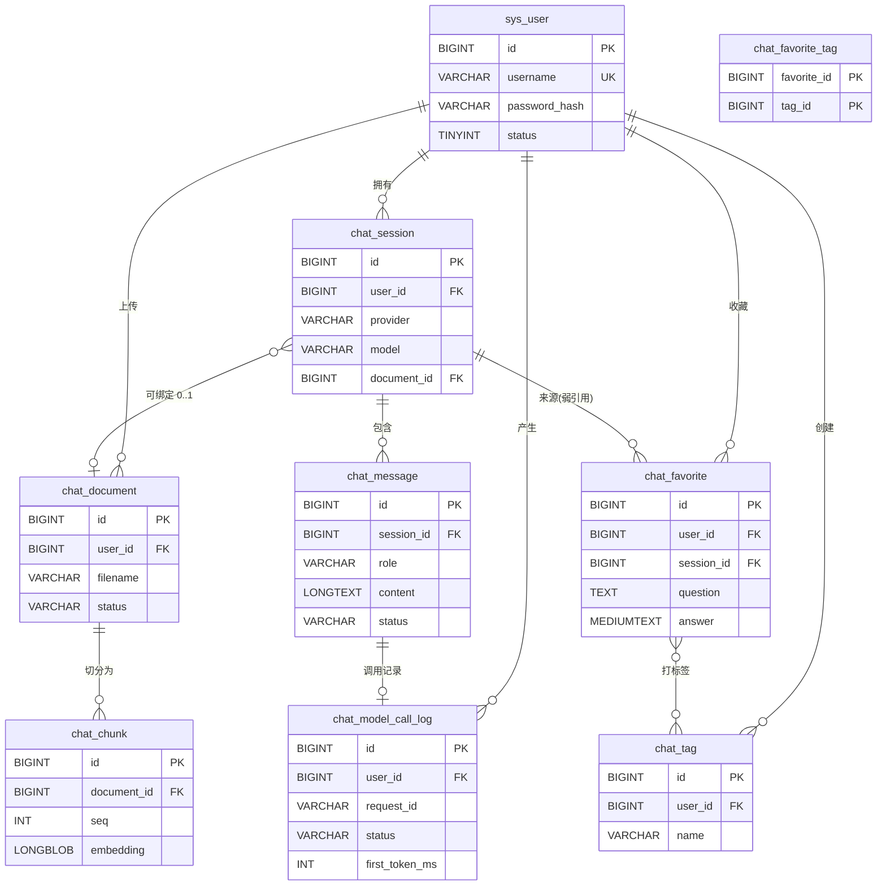

# 数据库设计

MySQL 8.0 / InnoDB / utf8mb4，共 **9 张表**。建表脚本：[`sql/schema.sql`](../sql/schema.sql)。

设计原则只有三条：

1. **消息不可变**：消息写入后不再修改内容，只允许回填状态（`STREAMING → COMPLETED/ABORTED/FAILED`）；
2. **MySQL 是唯一真相源**：Redis 里的上下文窗口、限流计数、token 配额都是可丢的缓存/计数器，丢了能从库里重建；
3. **删除是物理删除**：不做 `is_deleted` 软删，靠"收藏存快照"解决历史引用问题（见 [ADR-0003](../docs/adr/0003-hard-delete-with-favorite-snapshot.md)）。

---

## E-R 图

> 图中没有画物理外键（`FOREIGN KEY`），实际约束由 Service 层保证 —— 见下文"为什么没有外键"。

---

## 表结构明细

### 1. `sys_user` 用户

| 字段 | 类型 | 说明 |
|---|---|---|
| `id` | BIGINT AI | 主键 |
| `username` | VARCHAR(50) | 登录名，唯一索引 `uk_username` |
| `password_hash` | VARCHAR(100) | BCrypt 密文（`$2a$10$...` 60 字符，留余量） |
| `nickname` | VARCHAR(50) | 展示名 |
| `status` | TINYINT | 1 正常 / 0 停用 |
| `created_at` / `updated_at` | DATETIME | 自动维护 |

### 2. `chat_session` 会话

| 字段 | 类型 | 说明 |
|---|---|---|
| `id` | BIGINT AI | 主键 |
| `user_id` | BIGINT | 归属用户，**所有查询必带** |
| `title` | VARCHAR(100) | 首条提问截断 20 字，可重命名 |
| `provider` / `model` | VARCHAR | 会话级模型绑定 |
| `document_id` | BIGINT NULL | 可空：绑定了才能做文档问答 |
| `last_message_at` | DATETIME | 列表排序用 |

索引 `idx_user_last (user_id, last_message_at)`：会话列表按 `user_id` 过滤、按最近活跃排序，一个联合索引覆盖。

### 3. `chat_message` 消息

| 字段 | 类型 | 说明 |
|---|---|---|
| `id` | BIGINT AI | 主键，**自增即时间序**，天然可做"最近 20 条" |
| `session_id` / `user_id` | BIGINT | `user_id` 冗余，避免每次分页都 join 会话做权限校验 |
| `role` | VARCHAR(20) | `user` / `assistant` |
| `content` | LONGTEXT | 回答可能几万字，LONGTEXT 不占行内空间 |
| `provider` / `model` | VARCHAR | **实际生效**的模型（可能被降级），不是会话里选的那个 |
| `token_in` / `token_out` | INT | 用量，统计与配额都靠它 |
| `status` | VARCHAR(20) | `STREAMING` / `COMPLETED` / `ABORTED` / `FAILED` |
| `latency_ms` | INT | 端到端耗时 |

索引 `idx_session_id (session_id, id)`：`WHERE session_id=? ORDER BY id DESC LIMIT n` 是最高频查询（历史分页 + 上下文重建）。

### 4. `chat_document` 文档

| 字段 | 类型 | 说明 |
|---|---|---|
| `id` / `user_id` | BIGINT | |
| `filename` | VARCHAR(255) | 原文件名 |
| `byte_size` / `char_count` / `chunk_count` | INT | 上传后的统计，展示用 |
| `status` | VARCHAR(20) | `PARSING` / `READY` / `EMBED_FAILED` |

索引 `idx_user (user_id)`：列表查询 + 配额校验（每用户 ≤10 份）。

### 5. `chat_chunk` 文档片段（RAG 的最小检索单位）

| 字段 | 类型 | 说明 |
|---|---|---|
| `id` / `document_id` / `user_id` | BIGINT | `user_id` 冗余，检索时可直接带用户条件 |
| `seq` | INT | 片段的原始顺序，引用"片段 N"时用它 |
| `content` | TEXT | 400 字左右，TEXT 足够 |
| `embedding` | LONGBLOB | **float32 小端序列**，1024 维 ≈ 4KB/行 |
| `token_est` | INT | 估算 token，用于检索后的预算控制 |

索引 `idx_document (document_id)`：一次取全部分片算余弦。

### 6. `chat_favorite` 收藏（问答快照）

| 字段 | 类型 | 说明 |
|---|---|---|
| `id` / `user_id` | BIGINT | |
| `session_id` | BIGINT NULL | **弱引用**：只用于展示来源，不参与级联删除 |
| `question` | TEXT | **快照**：原样拷贝当时的问题 |
| `answer` | MEDIUMTEXT | **快照**：原样拷贝当时的回答 |
| `provider` / `model` | VARCHAR | 当时用的模型，便于追溯 |

索引 `idx_user_created (user_id, created_at)`：收藏列表按时间倒序。

### 7. `chat_tag` 标签

| 字段 | 类型 | 说明 |
|---|---|---|
| `id` / `user_id` | BIGINT | 标签是**用户私有**的 |
| `name` | VARCHAR(30) | |

唯一索引 `uk_user_name (user_id, name)`：同一用户不能建重名标签，靠数据库兜底而不是先查后插。

### 8. `chat_favorite_tag` 收藏-标签关联

联合主键 `(favorite_id, tag_id)` + `idx_tag (tag_id)`。前者保证幂等，后者支撑"按标签筛收藏"。

### 9. `chat_model_call_log` 模型调用日志

| 字段 | 类型 | 说明 |
|---|---|---|
| `user_id` / `session_id` / `message_id` | BIGINT | 可定位到具体某一轮 |
| `request_id` | VARCHAR(40) | 同时是日志的 `traceId`（MDC 注入） |
| `provider` / `model` | VARCHAR | 实际调用方 |
| `status` / `http_status` | | `SUCCESS` / `FAILED` + 上游状态码 |
| `token_in` / `token_out` | INT | |
| `latency_ms` / `first_token_ms` | INT | **首字延迟单独记**，流式体验的核心指标 |
| `retry_count` | INT | 重试了几次 |
| `error_code` / `error_msg` | VARCHAR(40)/(255) | 统一错误码 + 截断的上游报文 |

索引 `idx_user_created (user_id, created_at)`：统计页按人/按天聚合。

---

## 关键设计决策

### 为什么收藏存快照，而不是外键指向消息？

因为删除会话是**物理删除**。如果收藏指向 `chat_message.id`，删会话后收藏就变成死链，只能靠软删兜着。存快照后：

- 删会话 → 收藏照样能读、能按标签筛；
- 代价是同一段回答存两份（问答各一份），但收藏本来就是低频操作，几 KB 的冗余换来"引用完整性问题的彻底消失"。

### 为什么删会话是硬删，不做 `is_deleted`？

用 MyBatis 手写 XML 的情况下，软删意味着**十几条查询每条都要记得加 `and is_deleted = 0`**，漏一条就是脏数据，索引选择性也会变差。项目体量下，硬删 + 快照是更划算的组合。

### 为什么 `chat_message` 冗余 `user_id`？

历史分页、上下文重建都要校验"这条会话属于当前用户"。如果只存 `session_id`，每次都得 join `chat_session` 才能做越权校验；冗余一列换来所有消息查询都能直接带 `user_id` 条件，索引也能联合。

### 为什么向量存 BLOB 而不是 JSON？

1024 个 float32 = 4KB。JSON 文本大约要 15~20KB，且读取时要解析字符串。BLOB 用 `ByteBuffer` 直接映射成 `float[]`，序列化/反序列化零解析成本。

### 为什么没有物理外键？

1. 分片/迁移时外键会变成负担；
2. 本项目的"删除"都是有明确顺序的（先删子表再删主表），由 Service 层的事务保证；
3. 保留索引但去掉约束，插入性能更好。

代价是"脏数据只能靠代码保证"—— 这是刻意的取舍，写在 ADR 里。

---

## 容量估算（演示规模）

| 表 | 单条大小 | 一月量级（假设） | 备注 |
|---|---|---|---|
| `chat_message` | 1~30 KB | 1 万条 ≈ 100 MB | 回答是大头，LONGTEXT 不占行内空间 |
| `chat_chunk` | 4~6 KB | 50 份文档 × 500 片 ≈ 150 MB | 向量占 4KB/片 |
| `chat_model_call_log` | ~200 B | 10 万条 ≈ 20 MB | 可按月归档 |
| 其余表 | 小 | < 10 MB | |

结论：**单机 MySQL 完全够用**，这个体量上向量数据库没有意义（见 [ADR-0004](../docs/adr/0004-rag-in-memory-cosine.md)）。
